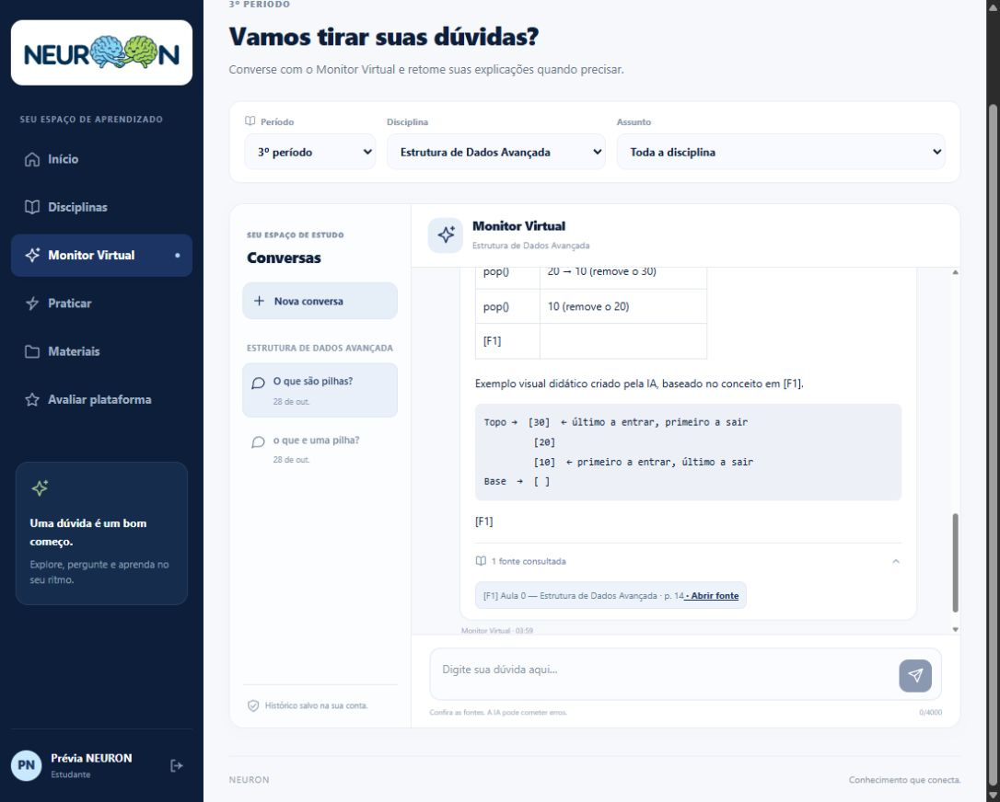

# NEURON
## Relatório de desenvolvimento e validação

**Data:** 28 de outubro de 2026

**Ambiente:** desenvolvimento local. Consolidação das evidências registradas na entrega, sem nova execução dos testes para esta emissão.

### 1. Objetivo

Implementar o backend de Estrutura de Dados Avançada com base nos PDFs de modelagem e classes, integrá-lo à IA e à interface derivada do protótipo e ampliar o comportamento conversacional do componente de RAG das disciplinas já trabalhadas.

### 2. Resultado executivo

| Indicador | Resultado registrado |
| --- | --- |
| Testes automatizados | 165 aprovados: 34 do backend, 117 da IA e 14 da interface. |
| Validação com modelo real | 16 cenários aprovados nas quatro disciplinas, sem falhas no relatório final. |
| Base preservada | 955 trechos indexados, sendo 167 de Estrutura de Dados Avançada. |

### 3. Arquitetura e abrangência

React → Spring Boot → FastAPI → recuperação em PostgreSQL/pgvector → modelo de IA. O Spring concentra autenticação, autorização e histórico; o Python executa recuperação e geração. O navegador não recebe chaves do provedor nem acessa diretamente o serviço interno de IA.

| Disciplina | Trechos | Abrangência desta etapa |
| --- | --- | --- |
| Estrutura de Dados Avançada | 167 | Catálogo do 3º período, 14 assuntos, três aulas, materiais e Monitor integrados à interface. |
| Estatística | 208 | Monitor compartilhado atualizado; catálogo e funções existentes preservados. |
| Design de Artefatos Digitais | 363 | Continuidade conversacional validada no serviço de RAG. |
| Projeto de Ideação de Software | 217 | Continuidade conversacional validada no serviço de RAG. |

A atualização do motor de RAG não cadastrou novas disciplinas na interface. Na prévia conferida, o catálogo apresentava Estatística e Estrutura de Dados Avançada.

<!-- page -->
# Entregas e correções

### 4. Backend e materiais de Estrutura de Dados Avançada

- Migration V4 com a disciplina, os 14 assuntos e os arquivos Aula_0.pdf, Aula_1.pdf e Aula_2.pdf.
- Vinculação dos 167 trechos aos IDs relacionais de período, disciplina, assunto e material, sem alterar os textos ou recalcular embeddings.
- Abertura autenticada dos materiais e links para as páginas citadas. O caminho real do arquivo é validado dentro da pasta autorizada.
- Reexecução da integração sem duplicação ou alterações; preservação dos dados das outras disciplinas conferida.

### 5. Problemas identificados e soluções

| Problema observado | Diagnóstico e solução |
| --- | --- |
| Recusa de perguntas sobre pilhas | O trecho correto tinha escores 0,1986 e 0,1970, abaixo do corte experimental 0,25. ED passou a combinar busca semântica e lexical, com variantes como pilha/pilhas. |
| Falha em “explique melhor” ou “mais visual” | O histórico era exibido, mas não enviado à IA. O backend passou a fornecer as oito mensagens recentes da mesma conversa para contextualizar a nova busca. |
| Esquemas ausentes na resposta | O verificador removia blocos sem citação explícita. Os visuais passaram a ter conteúdo e IDs de fontes estruturados, com um reparo de formato limitado quando necessário. |

### 6. Comportamento conversacional

O Monitor usa o contexto recente para compreender continuações, adaptar a explicação e acompanhar mudanças de tema. Cada pergunta refaz a busca nos materiais com os filtros atuais. Analogias, exemplos e esquemas novos são identificados como criações didáticas da IA, citando a base conceitual sem atribuir o exemplo ao professor.

### 7. Controles de acesso e fundamentação

- Histórico limitado à mesma conta, conversa, disciplina e assunto: até oito mensagens de 2000 caracteres cada.
- Mensagens antigas não substituem fontes acadêmicas. Materiais revogados ou indisponíveis continuam bloqueados na recuperação.
- Referências inexistentes são rejeitadas. Sem material suficiente, a IA não deve apresentar uma resposta como fundamentada; referências vagas podem motivar um pedido de esclarecimento.

<!-- page -->
# Validação e evidências

### 8. Testes automatizados

| Camada | Quantidade | Cobertura principal |
| --- | --- | --- |
| Backend Spring Boot | 34 | Autenticação, contexto, histórico, isolamento, catálogo, materiais e regras de prática. |
| Serviço de IA | 117 | Recuperação, contratos, continuidade, mudança de tema, fontes, diagramas e reparo limitado. |
| Interface React | 14 | Histórico, envio e falhas, tabelas, esquemas, materiais, avaliação e prática. |
| Total | 165 | Aprovados nas execuções registradas nesta entrega. |

### 9. Validação com o modelo real

Para cada uma das quatro disciplinas foram aprovados quatro cenários: pergunta inicial, continuação didática/visual, outro exemplo criado pela IA e pergunta independente sem cobertura nos arquivos. As perguntas iniciais trataram de pilhas, média aritmética, proximidade na Gestalt e matriz CSD.

| Disciplina | Cenários aprovados |
| --- | --- |
| Estrutura de Dados Avançada | 4 de 4 |
| Estatística | 4 de 4 |
| Design de Artefatos Digitais | 4 de 4 |
| Projeto de Ideação de Software | 4 de 4 |
| Total | 16 de 16, sem falhas no relatório final |

Uma conta temporária confirmou o percurso público Spring → contexto da conversa → IA, a resposta visual na segunda pergunta e a reabertura das quatro mensagens com suas fontes. A conta e seus dados temporários foram removidos.

### 10. Evidências da entrega

- E1. docs/CHAT_CONVERSACIONAL_RAG.md e docs/BACKEND_ED_AVANCADA.md: consolidação da implementação e dos resultados.
- E2. neuron-ai/saidas_testes/validacao_conversa_rag.json: 16 cenários e nenhuma falha registrada.
- E3. neuron-ai/saidas_testes/validacao_backend_contexto.json: percurso público aprovado e remoção da conta temporária.
- E4. backend/demo/build/test-results/test: resultados XML do backend. Logs da sessão de desenvolvimento: execuções da IA e da interface.
- E5. Arquivos ed_avancada_integracao_materiais.json e ed_avancada_integracao_repeticao.json, em neuron-ai/saidas_testes: vínculos e reexecução sem alterações.

<!-- page -->
# Prévia e próximos passos

### 11. Registro visual

A captura mostra a continuação sobre pilhas, o exemplo identificado como criação da IA, um esquema textual e a referência à Aula 0, página 14. A conversa demonstrativa foi mantida no histórico com o título “O que são pilhas?”. O rascunho anterior do usuário foi preservado sem envio.

Figura 1. Prévia local do Monitor Virtual, registrada em 28/10/2026.

### 12. Limites e pendências

- A memória é uma janela recente, não um histórico ilimitado de todas as conversas.
- Os recursos visuais desta etapa são tabelas e esquemas em texto; não há geração de imagens.
- A prática de ED permanece desabilitada até existirem listas ou provas elegíveis e autorizadas. Os slides não foram tratados como avaliações.
- O SSE entrega o texto após a geração completa. Hospedagem pública, testes de carga e validação de produção não foram demonstrados nesta entrega.
- As amostras confirmam os cenários executados, sem garantir correção acadêmica de toda resposta futura. Recomenda-se avaliação contínua com perguntas e materiais dos professores.

**Situação final:** integração e comportamento conversacional implementados e validados no ambiente local, com continuidade da evolução condicionada às pendências descritas.
